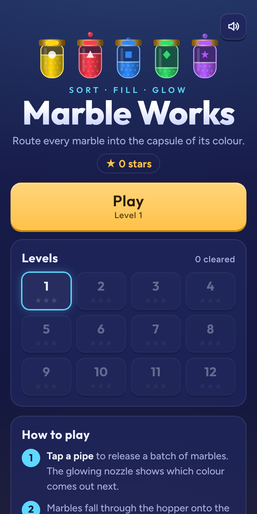
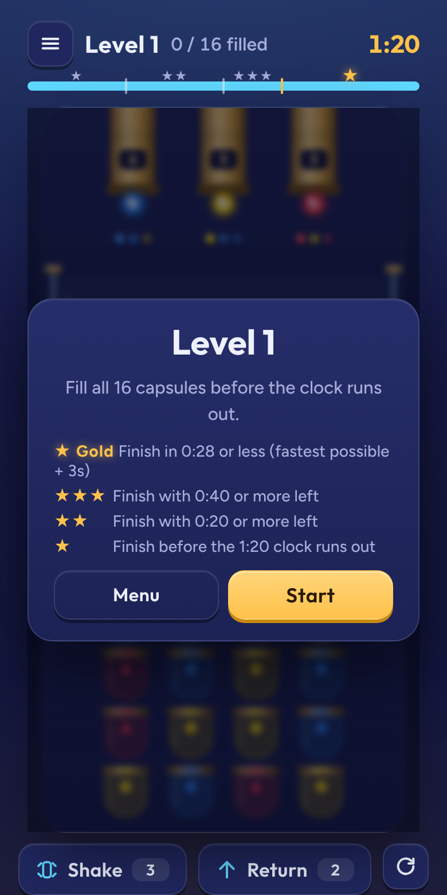
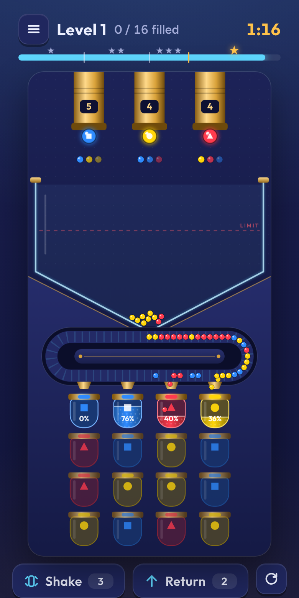

# Marble Works

[](https://github.com/Asmo7791/marble-works/actions/workflows/test.yml)
[](https://github.com/Asmo7791/marble-works/actions/workflows/pages.yml)
[](LICENSE)

Sort glowing marbles into the capsule of their colour. A calm, quick puzzle game for ages 5 to 11 that plays on phones, tablets and computers, online or off.

### [▶ Play now](https://asmo7791.github.io/marble-works/) · [Download for desktop](https://github.com/Asmo7791/marble-works/releases/latest)

<p align="center">
  
  
  
</p>

## Features

- **Easy to learn:** tap a pipe, marbles roll down the track, and each capsule only takes its own colour.
- **Colour-blind friendly:** every colour also has its own shape (circle, triangle, square, diamond, star).
- **Shake and Return powers** for when the hopper gets stuck.
- **Stars for speed**, plus a gold star for near-perfect clears.
- **Works offline** and saves progress on the device. No accounts, no ads, no tracking.

See [How to play](docs/HOW-TO-PLAY.md) for the full rules.

## Install it as an app

| Device | How |
| --- | --- |
| iPhone / iPad | Open the [game link](https://asmo7791.github.io/marble-works/) in Safari, tap **Share**, then **Add to Home Screen**. |
| Android | Open the link in Chrome, tap **⋮**, then **Install app**. |
| Windows / Mac / Chromebook | Open the link in Chrome or Edge and click the install icon in the address bar. |
| Desktop app | Download from [Releases](https://github.com/Asmo7791/marble-works/releases/latest): `.exe` for Windows, `.dmg` for Mac, `.AppImage` for Linux. |

The desktop downloads are not code-signed yet, so the first launch shows a warning. On Windows click **More info → Run anyway**. On Mac right-click the app, choose **Open**, then **Open** again.

## Project layout

```
web/            The game itself (one HTML file) plus app manifest, offline worker, icons and fonts
desktop/        Electron wrapper that packages web/ as Windows, Mac and Linux apps
tests/          Browser smoke tests (Playwright)
scripts/        Local server and screenshot generator
docs/           How to play, screenshots
.github/        CI workflows, issue and pull request templates
```

## Development

Needs [Node.js](https://nodejs.org) 20 or newer.

```sh
npm install
npx playwright install chromium   # first time only
npm start                         # play at http://localhost:8080
npm test                          # run the smoke tests
npm run screenshots               # refresh docs/screenshots
```

Desktop app: `cd desktop && npm install && npm start`.

See [CONTRIBUTING.md](CONTRIBUTING.md) for how changes and releases work.

## Privacy

Marble Works collects nothing. See [PRIVACY.md](PRIVACY.md).

## License

[MIT](LICENSE) © 2026 Kai
